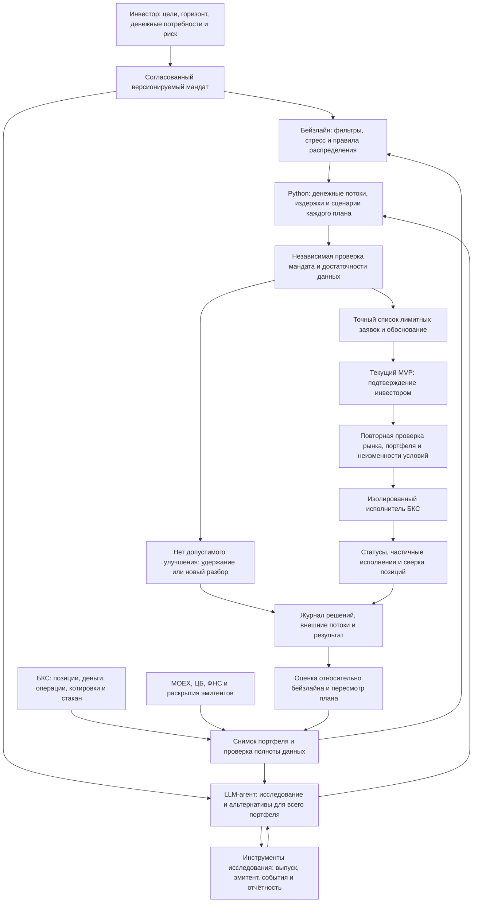

# ML System Design Doc — Invest Agent

Автор: Андрей Яковлев. Дата: 29.10.2026.
Стадия: развитие существующего MVP; HW1 — сетап и проектирование системы.
Структура основана на [шаблоне Reliable ML](https://github.com/IrinaGoloshchapova/ml_system_design_doc_ru/blob/main/ML_System_Design_Doc_Template.md).

## 1. Цели и предпосылки

### 1.1. Зачем идём в разработку продукта

Invest Agent — агент управления инвестиционным портфелем частного инвестора.
Инвестор передаёт ему портфель, задаёт цели и согласует инвестиционный мандат.
Агент анализирует весь переданный портфель, исследует инструменты, выбирает
между удержанием, покупкой и продажей, исполняет разрешённые операции и
отслеживает результат. Какую часть своего капитала передать в управление,
инвестор решает самостоятельно.

Цель продукта — повысить качество соотношения риска и доходности портфеля и
снизить трудозатраты инвестора на исследование и управление. Агент должен
помогать достигать разных целей: накопления капитала, регулярного денежного
потока, сохранения средств к сроку. Достижимость целей зависит от капитала,
горизонта и принятого риска; система должна выявлять противоречия и предлагать
компромиссы, а не обещать одновременно максимальную доходность и сохранность.

Целевое состояние — автономное управление: покупки и продажи внутри
согласованного мандата без подтверждения каждой операции. В текущем MVP
человек подтверждает конкретные сделки. Изменение мандата требует решения
инвестора и в целевой системе.

Сегодня уже существует облигационная версия с источниками данных, расчётами,
рекомендациями и исполнителем. Следующий продуктовый инкремент — связать эти
части в проверяемый цикл управления: профиль инвестора, план портфеля,
решение, исполнение, оценка результата и пересмотр плана.

LLM используется для понимания целей, планирования исследования, сопоставления
разнородных свидетельств и подготовки обоснованного инвестиционного решения.
Польза такого подхода проверяется относительно текущих правил и простых
стратегий. Денежные расчёты и проверка ограничений выполняются программно.
Обучение собственной модели не является обязательным условием проекта.

Успех — решения соответствуют мандату, финансовый результат измеряется
корректно, а инвестор тратит меньше времени на полный цикл управления.
Улучшение доходности при сопоставимом риске — проверяемая гипотеза продукта;
короткая серия удачных сделок сама по себе её не подтверждает.

### 1.2. Бизнес-требования и ограничения

#### Инвестиционный профиль и мандат

Агент выясняет цели, горизонт, потребность в выплатах, планируемые пополнения
и изъятия, ограничения и отношение к потерям. Он различает готовность
инвестора рисковать и его способность понести потери. Затем показывает
достижимые варианты риска и доходности и фиксирует выбранный мандат.
Такой подход соответствует практике индивидуального управления: профиль
содержит ожидаемую доходность, допустимый риск и инвестиционный горизонт
([Банк России](https://cbr.ru/Queries/XsltBlock/File/62016/65),
[CFA Institute](https://www.cfainstitute.org/insights/professional-learning/refresher-readings/2026/basics-of-portfolio-planning-and-construction)).

Мандат включает цели и их приоритеты, валюту, горизонт, ограничения по риску,
ликвидности и концентрации, допустимые инструменты, план денежных потоков,
порядок пересмотра и полномочия агента. Если для оценки способности нести
потери нужны сведения вне переданного портфеля, агент запрашивает их и
фиксирует границы доступной информации.

| Бизнес-требование | Ожидаемое поведение и проверка |
| --- | --- |
| Управлять всем переданным портфелем | Покупки и продажи оцениваются по влиянию на портфель целиком; существующие позиции входят в анализ |
| Поддерживать разные цели инвесторов | Цели и ограничения хранятся в версионируемом мандате; персональные настройки не становятся общими константами |
| Выбирать компромисс риска и доходности | Сравниваются альтернативы и сценарии; недостижимая цель явно обсуждается с инвестором |
| Исследовать рынок и эмитентов | Для существенных фактов сохраняются источник, время и привязка к выпуску/эмитенту |
| Формировать исполнимый план | Действия содержат инструмент, сторону, количество, лимитную цену, издержки и влияние на ограничения |
| Объяснять решение | Показаны основания, альтернативы, риски, неопределённость и условия пересмотра |
| Учитывать выбор человека | Отклонённая рекомендация и фактически выбранная сделка различаются в журнале |
| Контролировать исполнение | Подтверждены состояние заявки, частичные исполнения и итоговые позиции; повторный запуск не дублирует заявку |
| Реагировать на изменения | Устаревшее предложение блокируется; новые условия требуют нового плана и подтверждения в текущем режиме |
| Уметь бездействовать | Отсутствие подходящей возможности допускает сохранение денег или защитное размещение; падение цены само по себе не означает продажу |
| Оценивать результат | Учитываются сделки, купоны, погашения, комиссии, налоги при наличии данных и внешние денежные потоки |

#### Ограничения

Текущая предметная область — российский облигационный портфель. Имеющиеся
акции учитываются в общей структуре и риске; качество самостоятельной стратегии
акций в этой итерации не заявляется. Основной брокер MVP — БКС, интерфейс —
диалог с Codex. Мультиброкерность и массовый клиентский сервис отложены.

Мандат существующего пилота описан в [INVESTMENT_MANDATE.md](INVESTMENT_MANDATE.md)
и `config/investment_policy.toml`: ориентир 20% годовых, горизонт 5–10 лет,
риск-бюджет просадки 10–15%. Это настройки одного инвестора, а не требования
ко всем пользователям. Ожидаемая доходность не гарантируется; сценарный стресс
не равен фактической максимальной просадке и не гарантирует её ограничения.

Текущий режим сохраняет отдельное подтверждение конкретных сделок и
изолированный исполнитель. Аналитика не получает торговый токен. Запрещены
плечо, деривативы, выводы и переводы; заблокированные иностранные активы —
только удержание. При изменении инструмента, стороны, объёма или лимитной цены
нужно новое подтверждение. Нельзя повышать риск ради достижения цели доходности.

При недоступных или противоречивых данных агент обозначает пробел и блокирует
решения, для которых эти данные критичны. Внешние документы — источник фактов,
их инструкции не исполняются. Секреты и персональная история брокерского счёта
не публикуются в учебном репозитории.

### 1.3. Скоуп проекта и итерации

| Область | Состояние и границы |
| --- | --- |
| Существующий фундамент | Чтение БКС, MOEX, рейтинги ЦБ, РСБУ ФНС, индекс раскрытий, сценарии ставок, правила рекомендаций, policy engine, подтверждение и исполнитель |
| HW1 | Ruff, форматирование, pre-commit, CI, README и дизайн всей системы |
| Следующий проверяемый инкремент | Профиль и версия мандата, журнал полного цикла решения, учёт денежных потоков и результата, оценка на реальном портфеле |
| Развитие агентного анализа | Планирование исследования, сравнение действий по всему портфелю, проверка достаточности доказательств, пересмотр позиции |
| Целевая автономность | Самостоятельные покупки и продажи в рамках согласованного мандата после отдельной проверки готовности; текущие разрешения на торговлю не расширяются |
| Вне текущей итерации | Своя обученная LLM, высокочастотная торговля, деривативы, мультиброкерность, промышленный сервис для множества клиентов |

Извлечение отчётности с цитатами — возможный инструмент исследования эмитента,
а не отдельная цель продукта. Его приоритет определяется тем, какие данные
необходимы для конкретного инвестиционного решения.

Код воспроизводится из lock-файла; тесты работают на fixtures без боевых токенов.
Эксперимент фиксирует снимок данных, версию кода, мандата, модели и промпта.
Планируемый технический долг: ручная сверка части брокерской истории,
ограниченная полнота исторических источников, локальное хранение, отсутствие
постоянного фонового контроля. Эти ограничения учитываются при оценке пилота.

### 1.4. Предпосылки решения

- Агент управляет только явно переданным портфелем и в пределах согласованных
  полномочий. Мандат пересматривается при изменении целей или обстоятельств.
- Для решений нужны позиции и доступные деньги, котировки и ликвидность,
  денежные потоки выпусков, кредитные сведения и сведения о существенных событиях.
- Единицы анализа: портфель, эмитент по ИНН, выпуск по ISIN и регистрационному
  номеру. Риск концентрации агрегируется по эмитенту; связь с группой требует
  отдельного подтверждения.
- Горизонт цели клиента отличается от горизонта модели. Текущие сценарии ставок
  рассматривают 12 месяцев; денежные потоки облигации — до погашения/оферты.
- Рейтинг — свидетельство кредитного качества; используемый сценарный haircut
  не является вероятностью дефолта. РСБУ юрлица не заменяет МСФО группы.
- Пересмотр вызывается пополнением, существенным событием, изменением мандата
  или плановым обзором. Частота торговли определяется полезностью изменения
  после издержек; ежедневное наблюдение не требует ежедневных сделок.
- Доходность к погашению отдельной бумаги не равна реализованной доходности
  портфеля. Без полной истории внешних потоков доходность не рассчитывается.

## 2. Методология

### 2.1. Постановка задачи

Задача — последовательное принятие решений по управлению портфелем при
ограничениях и неопределённости. Состояние включает позиции, деньги, рыночные
и кредитные сведения, историю операций и мандат. Действия — удержание,
покупка, продажа, изменение распределения и запрос недостающих сведений.

Для множества допустимых планов A(s, m), определяемого состоянием s и мандатом m,
выбирается план с наибольшей ожидаемой полезностью для целей инвестора после
издержек. Полезность учитывает доходность, риск и сроки денежных потребностей.
Единую функцию полезности для всех клиентов заранее не задаём: параметры
определяются профилем, а альтернативы показываются через сценарии.

**Бейзлайн:** текущий детерминированный механизм рекомендаций: фильтры выпусков,
рейтинговые стресс-сценарии, лимиты концентрации и сравнение удержания,
вложения кэша и ребалансировки. Его версию и настройки фиксируем до оценки.

**Развиваемое решение:** агент на готовой LLM выбирает необходимые исследования,
собирает свидетельства, формирует несколько структурированных планов и
обосновывает выбор. Python-инструменты рассчитывают каждый план; независимый
policy engine проверяет ограничения. Агент не может отменить запрет текстом.
Противоречия запускают уточнение/пересчёт, а не обход проверки.

Обучение своей модели и reinforcement learning на реальном счёте не требуются.
Качество оценивается на уровне всего цикла: обоснование, соответствие мандату,
исполнение и последующий финансовый результат.

### 2.2. Блок-схема решения

Бейзлайн и развиваемый агент используют одинаковые снимки данных и проверки.

Целевая автономная версия заменяет подтверждение каждой сделки проверкой заранее
выданных полномочий в мандате. Это отдельный этап внедрения; HW1 не включает
изменение действующего торгового режима.

### 2.3. Этапы решения задачи

HW2: 15.11.2026. Выполненный анализ: [EDA](../reports/EDA.md),
[машиночитаемые показатели](../reports/eda_summary.json),
[исходный снимок](../datasets/raw/moex_bonds.json), [скрипт](../scripts/eda.py).
Ниже разделены полученные результаты и план развития. Изменение стратегии и
торгового режима в HW2 не входит.

#### Этап 1. Подготовка данных

**Сущности и доступность.** Единица рыночного снимка — выпуск × торговый режим ×
время; выпуск связывается с эмитентом отдельно. Единица оценки агента — эпизод
решения по портфелю с версией мандата и набором доступных на этот момент фактов.

| Данные | Источник, получение и формат | Что проверено / пробел | Ресурс |
| --- | --- | --- | --- |
| Справочник, цена, оборот, доходность и дюрация | Публичный MOEX ISS, HTTP JSON; в MVP запрос при анализе | EDA 3 493 строк, 3 179 выпусков; составной ключ уникален; снимок не история | Python-клиент и DS |
| Выплаты, амортизация, оферты | MOEX bondization с пагинацией, документы выпуска | Контрактные тесты; покрытие рынка в HW2 не проверено | Клиент и ручная проверка документов |
| Эмитент, рейтинг, отчётность и раскрытия | MOEX, ЦБ, ФНС, Интерфакс; JSON/HTML и ссылки PDF | Парсеры и fixtures есть; независимое покрытие всего рынка не измерено | Клиенты, разметчик предметной области |
| Мандат, позиции, деньги и операции | Версионируемый TOML, read-only API БКС, приватные журналы | Интеграция есть; полнота истории потоков не подтверждена, в публичный EDA не включены | Владелец счёта и read-only доступ |
| Эпизоды и эталоны действий | Предстоит сохранять входы, ответ, ссылки, отказ, вмешательство человека | Размеченного корпуса и целевой переменной будущего результата пока нет | Автор проекта и независимый ревьювер |

Снимок содержит securities=3 493, marketdata=3 493, marketdata_yields=2 519.
Повторных SECID по разным режимам — 314, дублей составного ключа нет.
Нет эффективной доходности/дюрации у 30,3%, LAST у 50,1%, BID/OFFER у 100%
строк. Время сделок включает 15 октября при загрузке 15 ноября. Доходность
имеет экстремумы до миллионов процентов; их нельзя превращать в верхние
позиции рекомендации. Рублёвых строк с оборотом, доходностью и положительной
дюрацией — 1 524, но ни одна не имеет двусторонней котировки в этом ответе.
Это главный риск перехода от исследования к заявке. Подробности и графики — в EDA.

**Генерация и обработка.** Сейчас получение данных запускается по запросу;
регулярный исторический сбор — планируемый компонент. Сначала сохраняем
неизменяемый raw, URL, UTC-время получения, SHA-256 и версию схемы. Затем
нормализуем типы, валюты и единицы: цена облигации в процентах номинала,
денежная стоимость с НКД отдельно; дюрация в днях, доходность в процентах,
рублёвый оборот отдельно от оборота в штуках. Нули не заменяют пропуски.
Таблицы соединяем по `(SECID, BOARDID)`, контролируя cardinality и orphan keys.
Для нескольких режимов выбираем доступный брокеру режим, а не первую строку.
Эмитента связываем по идентификатору MOEX/ИНН, не по сходству названий.
Витрина признаков содержит `observed_at`, `received_at`, `published_at`,
`source_url`, `missing_reason`; версия документа не должна перезаписывать историю.

Доходности к оферте и погашению, fixed/floating купоны, валюты, субординация и
структурные выплаты образуют разные группы сравнения. Значение вне ожидаемого
диапазона отправляется на проверку первичного документа; универсальный clipping
для финансового расчёта запрещён. Визуальное ограничение оси графика явно указано.

**Недостаток данных.** Одного снимка достаточно для EDA структуры, но недостаточно
для обучения и финансовой проверки. Планируем сохранять закрытие каждого торгового
дня и as-of снимок каждого решения, а стакан — непосредственно перед проверкой
исполнимости. Первый корпус: 100 независимых сценариев по 20 на пять групп
(normal, stale/missing, credit event, mandate conflict, execution failure),
с разными эмитентами и датами. Это план инженерной приёмки, не достаточный размер
для доказательства доходности. На development/validation/test выделить 60/20/20
эпизодов хронологически; связанные сценарии одного события не разносить по частям.
Для редких опасных случаев добавить синтетические adversarial-сценарии и учитывать
их отдельно от реальных. Два разметчика независимо проверяют факты, допустимость
действия и отказ; разногласия разрешаются до замораживания теста.

Для финансовой оценки нужен отдельный длительный ряд с разными режимами ставок
и кредитными событиями. Объём определяется минимальным полезным эффектом и
дисперсией парной разности результатов на development-окнах; сейчас их нет,
поэтому точный необходимый размер не заявлен. До накопления истории доступны
только проверка контрактов и prospective shadow-пилот.

**Конфиденциальность.** Публичный рыночный снимок не содержит счёта инвестора.
Позиции, суммы, соглашения, история сделок, мандаты и переписка остаются в
приватном хранилище с ограничением доступа; секреты — отдельно. В учебный
репозиторий попадают публичные данные и явно синтетические fixtures. Для
экспорта сценариев удаляются идентификаторы клиента и свободный текст с PII;
хеш номера счёта сам по себе не делает финансовую историю анонимной.

**Выход.** Для baseline — версионированный снимок, проверенные ключи, маски
доступности и причины исключений. Для MVP — те же входы плюс доказательства
фактов, журнал эпизодов и эталонная разметка. HW2 даёт первый публичный снимок
и EDA; история и размеченный корпус ещё не собраны.

#### Этап 2. Подготовка прогнозных моделей и оценка агента

Здесь используется готовая LLM с инструментами, а не обучаемый предиктор цены.
Её задача — построить обоснованный допустимый план по всему портфелю. Числа
и ограничения рассчитывает Python. Эффективная доходность биржи — входной
показатель, не метка будущей реализованной доходности.

**Baseline.** Зафиксировать commit текущего `manager.py`, конфигурацию и снимок.
Текущий rule-based алгоритм использует рейтинг, доходность, дюрацию, оборот,
концентрацию, резерв и стресс; он выдаёт HOLD/ADD_CANDIDATE/DO_NOT_ADD/
REDUCE_RISK/URGENT_REVIEW. Предобработка проверяет идентичность инструмента,
единицы и доступность полей; неполные кредитные факты не достраиваются LLM.
Дополнительный baseline — удержание стартового портфеля, с одинаковыми внешними
потоками. Для MVP LLM сравнивает альтернативы, привязывает доводы к источникам
и выдаёт структурированный план, после чего действуют те же расчёты и policy
engine. Все варианты получают одинаковые данные, ограничения и бюджет анализа.

**Метрики и потери.** Для модели без fine-tuning обучаемая loss отсутствует.
Качество оценивается на независимо размеченных эпизодах, а не самооценкой LLM.

| Метрика | Определение и причина выбора |
| --- | --- |
| Корректный структурированный ответ | Валидные ответы / все эпизоды, включая ошибки и таймауты; схема нужна для безопасного исполнения |
| Извлечение ограничений | Precision/recall по полям мандата; пропуск жёсткого ограничения отдельно является блокером |
| Подтверждённость фактов | Подтверждённые существенные утверждения / все проверенные существенные утверждения, отдельно численные; цитата должна поддерживать именно утверждение |
| Пропущенные нарушения | Разрешённые risk engine запрещённые эталоном действия / все запрещённые действия; целевой результат приёмки — 0 на тестовом наборе |
| Ложные запреты | Запрещённые допустимые действия / все допустимые действия; защищает полезность от отказа во всём |
| Корректность отказа | Precision/recall отказа при критичных пропусках или конфликте мандата; пустые знаменатели показываются как N/A |
| Выбор действия | Macro-F1 по допустимым классам действий на однозначных сценариях; при нескольких допустимых планах проверяется принадлежность эталонному множеству |
| Стоимость и задержка | Медиана/p95 времени, число вызовов и стоимость на эпизод, включая неудачные; проверяют нефункциональную пригодность |
| Финансовый эффект | Парная разность TWR после издержек при одинаковых потоках, просадка и кредитные события; XIRR отдельно для результата инвестора |

Численные утверждения сверяются с Decimal-расчётом с точностью единиц источника.
Доля нарушений имеет приоритет над F1 и доходностью: высокий средний score не
компенсирует опасную заявку. Даже 0 ошибок из 100 не доказывает нулевого риска:
приближённая верхняя 95%-граница вероятности ошибки около 3% при независимых
наблюдениях. Пока корпус не собран, метрики остаются планом, не результатами.

Если позже потребуется свой ranker, признаки — только as-of рейтинг и его
изменения, дюрация, спред к сопоставимой кривой, ликвидность, выплаты и показатели
эмитента с датой публикации. Цель на горизонте 90 дней — total return после
издержек относительно duration-matched ориентира, включая дефолты и выплаты.
Первый предиктор — медиана обучающей группы; далее линейная модель и бустинг.
Для доходности выбрать MAE в процентных пунктах (меньше влияние экстремумов,
чем у MSE), для ранжирования — pairwise logistic loss по парным excess returns.
Это будущая гипотеза: текущий снимок не содержит необходимых целевых значений.

**Валидация.** Промпты, FE, модели и лимиты выбираются только на development,
сравнение вариантов — на validation, финальный test открывается один раз.
Для 90-дневных меток исключаются эпизоды, чей горизонт пересекает начало
следующего окна (purge/embargo 90 дней); одна дата/событие не попадает в разные
части. Walk-forward выполняется только при накопленной истории; отдельно
проверяются новые эмитенты, плохая ликвидность, отрицательные исходы и пропуски.
Используется дата публикации сведений, а не конец отчётного года. Нельзя
отбирать только дожившие до сегодня выпуски и успешные рекомендации.

Ретроспективная LLM может знать события из предобучения даже при ограниченных
инструментах. Поэтому архивный replay проверяет процесс и ссылки, но не даёт
чистую финансовую оценку LLM. Основной тест — prospective shadow-период после
замораживания версии: ответы записываются до наступления исхода. Историческую
оценку детерминированного baseline можно проводить только на настоящих as-of
снимках. Интервалы финансового эффекта оцениваются блоками по датам, а не
считая каждый коррелированный выпуск независимым наблюдением.

**Развитие и интерпретация.** Сначала ablation: rule-based → LLM с теми же
данными → LLM с дополнительным исследованием, при одинаковом лимите затрат.
Ошибки разбираются по полям, источникам, эмитентам и классам действий; сохраняются
альтернативы, факты и условия изменения решения. Объяснение LLM не доказывает
причину ответа: проверяем изменение плана при контролируемом изменении входа.
Для обучаемого ranker добавляются permutation importance и проверка устойчивости
на временных окнах. Подбор гиперпараметров ограничивается заранее заданным
бюджетом на development; тестовые эпизоды не включаются в few-shot примеры.

**Риски и выход.** Основные риски — утечка будущего, суррогатная доходность вместо
результата, переобучение промпта на тесте, ложные факты и неограниченный расход.
Меры — замороженные наборы, prospective оценка, цитаты, независимый расчёт,
таймаут и лимит шагов. Выход baseline — воспроизводимые решения на фиксированных
входах; MVP — таблица парного сравнения с разбором ошибок и затрат. Допуск
требует нулевых пропущенных жёстких нарушений в тесте и подтверждённых численных
фактов; целевые SLA и финансовый эффект фиксируются после первых измерений.

#### Этап 3. Проверка мандата и сборка исполнимого плана

Вход — портфель, версия мандата, альтернативы и свидетельства. Baseline и MVP
передают планы одному независимому policy engine. Он проверяет инструменты,
концентрацию по эмитенту, резерв денег, стресс, доступность неквалифицированному
инвестору и запреты. Денежная сумма включает НКД, лотность, комиссии и шаг цены.
Отсутствие достаточных кредитных данных блокирует увеличение зависимого риска;
при отсутствии свежего стакана план не становится заявкой. Эффект каждого
действия оценивается по портфелю целиком, включая альтернативу ничего не менять.
Проверки включают нарушение каждого лимита, границу лимита, ложный запрет,
несколько выпусков одного эмитента и противоречивые данные. Выход — допустимый
план с причинами либо отказ с конкретным недостающим фактом. Планируемая
автономность не отменяет действующее отдельное подтверждение.

#### Этап 4. Исполнение и учёт результата

Для baseline финансовое сравнение ведётся на виртуальном портфеле с одинаковыми
стартовыми позициями и внешними потоками. Для MVP реальное исполнение доступно
только после отдельного подтверждения неизменяемого списка заявок; HW2 сделок
не выполняет. Повторно проверяются портфель, цена, объём стакана и срок действия.
Токен торговли доступен только изолированному исполнителю. Риски — дублирование,
частичное исполнение и неизвестный исход сети; защита — идентификатор операции,
журнал и сверка состояния до повторной отправки. Выход — подтверждённые статусы
и позиции, связанные с версией решения, а не сообщение «запрос отправлен».

Журнал различает рекомендацию агента, выбор человека, отправку и fill. Купоны,
погашения, сделки, комиссии и налоги отделены от внешних пополнений/изъятий.
TWR требует оценок на границах внешних потоков, XIRR — полной датированной истории;
при отсутствии этих входов показывается только изменение стоимости с оговорённым
пробелом. Бенчмарки отвечают разным вопросам: депозитный ориентир текущего TOML —
альтернативная стоимость денег, duration-matched total-return индекс — рыночная
сравнимость. Конкретный индекс и правила реинвестирования выбираются до теста
после проверки доступности исторического ряда; их доходности в HW2 не измерены.

#### Этап 5. Shadow-пилот и мониторинг

Обе версии получают последовательность новых снимков. Baseline фиксирован;
MVP работает без реальных заявок до отдельного допуска. Сохраняются решения,
затраты, отказы и вмешательства; сбой источника отличается от отсутствия данных.
Мониторинг проверяет свежесть, изменение схем, долю пропусков, покрытие рейтингов,
экстремумы доходности, расхождение расчётов и нарушения мандата. Изменение схемы
или критичные пропуски останавливают зависимое действие, сохраняя возможность
прочитать последнюю оценку с её датой. Рост пропусков относительно HW2 — сигнал
разобрать источник; этот снимок не служит вечной нормой для сезонного рынка.

Выход — отчёт о качестве решений, времени владельца, стоимости, финансовом
результате за доступный период и ограничениях доказательств. Отсутствие улучшения
или недостаточный объём ведут к продолжению наблюдения/пересмотру, а не заявлению
о превосходстве. Разрешение на автономные покупки и продажи остаётся отдельным
решением владельца после проверки полномочий, остановки и восстановления.

## 3. Подготовка пилота

### 3.1. Способ оценки

Первый пилот — существующий реальный портфель автора и его реальные сделки.
Новые операции выполняются только по отдельному разрешению владельца в текущем
режиме. Пилот не требует торговать ради количества наблюдений: решение
«ничего не менять» также сохраняется и оценивается.

Для каждого эпизода сохраняются доступные на тот момент данные, план агента,
план бейзлайна, выбор владельца, исполнение и последующие выплаты/стоимость.
Сравнение с бейзлайном ведётся на виртуальном портфеле с одинаковыми стартовыми
позициями и внешними потоками. Для виртуальных сделок учитываются доступная
ликвидность, спред и издержки; исполнение по недоступной цене не предполагается.
Если необходимых данных нет, сравнение помечается ограниченным.

Простая рыночная альтернатива — облигационный total-return индекс,
соответствующий валюте и дюрации пилота, либо доступная защитная стратегия.
Точный ряд и правила сравнения фиксируются после EDA до оценки. Сравнение
риска обязательно: более высокая доходность за счёт большего кредитного риска
не считается автоматическим улучшением.

| Измерение | Метод |
| --- | --- |
| Результат портфеля | TWR при достаточной оценке на границах внешних потоков; XIRR для опыта инвестора при полной истории датированных потоков |
| Риск | Фактическая просадка, концентрация, ликвидность, сценарный стресс и кредитные события; показатели не подменяют друг друга |
| Издержки | Комиссии, спред, оборот, налоги при наличии подтверждённых данных; неизвестные статьи отмечаются |
| Качество решения | Соблюдение мандата, корректность расчётов, доказательность существенных утверждений, наличие альтернатив и условий пересмотра |
| Исполнение | Отклонения от подтверждённых условий, дубли, отказы, частичные исполнения и сверка с брокером |
| Трудозатраты | Время владельца на эпизод и число содержательных исправлений; задержка и стоимость работы агента |

Сделка с прибылью может быть плохим решением, а обоснованная сделка — дать
убыток. Поэтому процесс и результат оцениваются отдельно. Один инвестор и
короткий период ограничивают переносимость выводов; показываются длительность,
число решений и рыночные условия, а не заявление о доказанной альфе.

### 3.2. Что считаем успешным пилотом

Обязательные условия приёмки:

- Каждое действие связано с действующей версией мандата и проходит независимые
  проверки. В текущем режиме ни одна сделка не отправлена без подтверждения;
  нет дублей и расхождений с разрешёнными параметрами.
- Для каждого исполненного действия есть проверяемый итог: статус, количество,
  цена при наличии брокерских данных, издержки и сверка позиций. Частичное
  исполнение не представляется полным.
- Существенные факты имеют источники и время; критический пробел данных
  блокирует зависимое решение. Модельные оценки обозначены как оценки.
- Результат считается только за период с достаточной историей потоков;
  прирост стоимости из-за пополнений не называется доходностью.
- Работает полный цикл от мандата до пересмотра результата, включая удержание,
  продажу и сценарии ошибок, а не только успешную покупку.

Гипотезы продуктовой ценности: доходность после издержек при сопоставимом риске
выше бейзлайна, риск лучше соответствует мандату, время владельца сокращается.
Для каждой показывается измеренный результат; числовые пороги превосходства
и минимальную длительность финансовой оценки определяем после EDA с учётом
доступного периода и частоты решений. В HW1 не заявляем выдуманные результаты
или произвольную гарантию доходности. Прохождение технической приёмки не
равнозначно доказанному финансовому превосходству и не разрешает автономную торговлю.

### 3.3. Подготовка и ресурсы

Текущая инфраструктура — локальный Python-проект, готовая LLM в Codex,
API источников, приватные снимки и журналы. GPU и обучение собственной модели
на этом этапе не нужны. Стоимость и длительность одного цикла измеряются
отдельно для планового обзора и углублённого исследования эмитента.

Для ограничения затрат используются кеширование с датой актуальности,
повторное использование снимка в одном эпизоде, лимит шагов исследования и
таймаут. По исчерпании бюджета агент возвращает неполный результат и
необходимые сведения, а не выдумывает вывод. Численные лимиты устанавливаются
по измерениям первых прогонов.

После проверки пилота отдельным решением определяется готовность к автономному
режиму: полномочия, лимиты операций, остановка при нарушениях, фоновый контроль
и восстановление после сбоя. Для вывода продукта на других инвесторов также
потребуются отдельная проработка правовой модели, доступа и изоляции данных.
