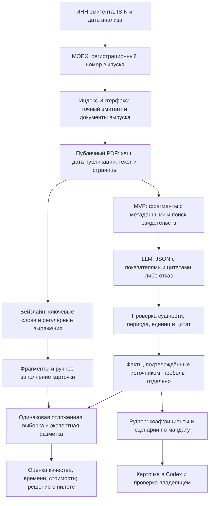

# ML System Design Doc — Invest Agent, учебный MVP

Дата: 29.10.2026. Автор и владелец продукта: Андрей Яковлев.
Итерация HW1: оформление проекта и проектирование ML-компонента.
Структура адаптирована из [шаблона Reliable ML](https://github.com/IrinaGoloshchapova/ml_system_design_doc_ru/blob/main/ML_System_Design_Doc_Template.md).

## 1. Цели и предпосылки

### 1.1. Зачем идём в разработку продукта

Частный инвестор с российским облигационным портфелем регулярно сопоставляет
позиции брокера, условия выпусков, рейтинги и отчётность эмитентов. Ручная
проверка занимает время, а пропуск существенного факта может привести к покупке
инструмента с неприемлемым риском. Invest Agent должен собирать эти сведения и
помогать владельцу принимать проверяемые решения через диалог в Codex.

В существующем проекте расчёты и риск-ограничения реализованы правилами.
Планируемая ML-часть — извлечение фактов из документов раскрытия с помощью LLM
и поиск подтверждающих фрагментов (RAG). Она нужна для обработки разнородных
текстов, которые текущий индекс умеет находить, но не читать. Доходность,
денежные суммы и ограничения продолжит рассчитывать Python-код.

Гипотеза ценности: карточка эмитента с проверяемыми цитатами сократит время
подготовки анализа без увеличения числа существенных ошибок. Целевое сокращение
медианного времени — не менее 30% относительно текущего ручного процесса;
исходное время ещё предстоит измерить. Рост доходности не является критерием
успеха учебной итерации: короткий пилот не позволяет отделить его от рынка.

### 1.2. Бизнес-требования и ограничения

| Требование | Проверка результата |
| --- | --- |
| Показать структуру портфеля и концентрацию по эмитентам | Сверка детерминированных сумм со снимком брокера |
| Объяснить риск облигации и пробелы в данных | Факт сопровождается источником, датой и областью применимости |
| Извлечь показатели МСФО и условия точного выпуска | Значение, единица, период, страница и цитата; иначе явный отказ |
| Сравнить удержание, вложение кэша и ребалансировку | Прозрачные сценарные расчёты с учётом мандата |
| Сохранить контроль владельца над сделками | Отдельное одноразовое подтверждение точного списка заявок |

Действующий мандат описан в [INVESTMENT_MANDATE.md](INVESTMENT_MANDATE.md).
Ориентир доходности 20% годовых не является обещанием. Горизонт владельца —
5–10 лет; допустимая просадка 10–15% — ограничение мандата, а не гарантия модели.
Запрещены плечо, деривативы, выводы и переводы; заблокированные иностранные
активы доступны только для удержания. Нельзя повышать риск ради целевой доходности.

Аналитика использует только read-only доступ. LLM не получает торговый токен
и не может менять policy engine. Для учебных экспериментов используются публичные
документы и синтетические портфели; персональные позиции и секреты не публикуются.
Документы рассматриваются как данные: содержащиеся в них инструкции не исполняются.
При недоступности источника результат помечается неполным.

Пилот: владелец выбирает эмитента, система находит документы, извлекает факты и
показывает карточку с цитатами. Владелец проверяет её по оригиналам и фиксирует
ошибки и время. Торговые операции для оценки ML-компонента не требуются.
Цели пилота ниже являются предложенными критериями, результаты ещё не получены.

### 1.3. Скоуп итерации

HW1 включает воспроизводимый сетап репозитория, Ruff, pre-commit, CI и этот
дизайн-документ. В существующей кодовой базе уже есть интеграции БКС, MOEX,
рейтингов ЦБ, РСБУ ФНС, индекс раскрытий, правила рекомендаций и изолированный
исполнитель; учебная работа использует их как исходный фундамент.

Следующий ML-инкремент: публичные документы выбранных эмитентов, извлечение
текста PDF, индекс фрагментов, извлечение показателей и условий с цитатами,
офлайн-оценка и карточка для владельца. Обучение собственной LLM, прогноз цен,
оценка вероятности дефолта, автоматические сделки и промышленный сервис
не входят в этот инкремент.

Результат должен воспроизводиться из зафиксированных версий зависимостей,
обезличенных fixtures и инструкций запуска. Будущие эксперименты фиксируют
версию модели, промпт, параметры, хеш документа и дату среза. Технический долг:
OCR сканов, фоновое обновление, промышленное хранилище и мониторинг будут
рассматриваться после проверки качества текстовых PDF.

### 1.4. Предпосылки решения

Единица анализа — эмитент по ИНН и выпуск по ISIN/регистрационному номеру.
РСБУ юридического лица нельзя подменять МСФО группы; условие одного выпуска
нельзя переносить на другой. Для факта нужны период отчётности, валюта,
масштаб единиц и точная ссылка. Отсутствие найденного условия не означает,
что условия нет.

Исходный индекс содержит ссылки и метаданные раскрытий; доступность файлов,
качество текста и права использования корпуса проверяются при сборе данных.
На первом этапе предполагаются русскоязычные текстовые PDF. Обновление — по
запросу; документы выбираются только из опубликованных к моменту анализа.
Собственная обучающая выборка пока отсутствует. Использование готовой LLM и
промптов — гипотеза, которую необходимо сравнить с простым поиском.

## 2. Методология

### 2.1. Постановка задачи

Задача ML — поиск свидетельств и структурированное извлечение информации.
Вход: ИНН, идентификатор выпуска, дата анализа и документы раскрытия.
Выход: факты вида `entity, field, value, unit, period, source, page, quote`
либо `not_found`/`ambiguous`. Первые поля: выручка, долг, денежные средства,
операционный денежный поток, ковенанты, обеспечение и гарантии.

Текстовые факты проходят проверку схемы, единиц и соответствия сущности.
Расчёт коэффициентов выполняется отдельно. Модель не предсказывает будущую
цену или доходность и не принимает окончательное инвестиционное решение.

### 2.2. Блок-схема решения

Бейзлайн планируется как поиск по ключевым словам и ручная проверка фрагментов;
существующий индекс раскрытий служит источником документов для обоих вариантов.

### 2.3. Данные и этапы

| Данные | Источник и состояние | Получение и качество |
| --- | --- | --- |
| Идентификаторы и графики выплат | Клиент MOEX уже реализован | Разработчик; контрактные тесты, свежесть проверяется при запуске |
| Ссылки на отчёты и документы выпусков | Индекс Интерфакс уже реализован | Разработчик; содержимое PDF пока не исследовано |
| Показатели РСБУ и рейтинги | Клиенты ФНС и ЦБ уже реализованы | Контекст проверки; не эталон МСФО или PD |
| Тексты и страницы PDF | Предстоит собрать публичный корпус | Разработчик; EDA извлечения текста и таблиц |
| Эталонные факты и цитаты | Предстоит разметить | Владелец как доменный эксперт; спорные случаи отдельно |
| Портфели для демонстрации | Синтетические fixtures | Разработчик; никаких персональных брокерских данных |

1. **EDA и корпус.** Начальный план — 30 документов не менее 10 эмитентов,
   включая годовые/промежуточные отчёты и условия выпусков. Измерить долю
   текстовых PDF, корректность таблиц, дубли и полноту идентификаторов.
   Зафиксировать manifest и недоступные документы; при недостаточном покрытии
   сузить поля и явно пересмотреть критерии до эксперимента.
2. **Разметка.** Разметить не менее 100 проверок полей, включая отсутствующие
   и неоднозначные значения. Целевая переменная — значение с единицей,
   периодом и подтверждающим фрагментом либо обоснованный отказ. Проверять
   каждую эталонную запись по оригиналу; записывать спорные случаи.
3. **Бейзлайн и MVP.** Бейзлайн возвращает совпадения по словарю и шаблонам;
   MVP добавляет поиск фрагментов и LLM с заданной схемой. Выбор модели,
   размера фрагментов и способа поиска производится на development-части.
   Fine-tuning в этой итерации не планируется.
4. **Оценка.** Разделить корпус по эмитентам примерно 60/20/20 на разработку,
   валидацию и test; один эмитент и дубли его документов не пересекают части.
   Точный список и число примеров фиксируются после EDA. Промпты не меняются
   по результатам test. Оба решения получают одинаковые документы и вопросы.
   Для исторического анализа действует ограничение даты публикации.
5. **Интеграция и пилот.** Только после офлайн-проверки подключить извлечение
   к карточке. Ошибка валидации закрывает использование факта в расчётах.
   Проверить таймауты, отсутствие текста и ложные совпадения ИНН/ISIN.

Метрики: precision извлечённых фактов (верные среди выданных), recall (найденные
среди доступных в эталоне), доля подтверждённых цитат, корректность отказов,
задержка и стоимость на документ. Числовой факт верен только при совпадении
значения после нормализации, единицы, периода и сущности; текстовый — после
экспертной проверки смысла. Отдельно считать ошибки переноса между выпусками.
Показывать числители и знаменатели: маленький корпус не доказывает надёжность
на всех эмитентах.

Риски: сложные таблицы, сканы, смешение группы и юрлица, галлюцинации, неверная
дата среза. Меры: отказ на неподдерживаемых документах, строгие идентификаторы,
цитаты, временной фильтр и ручная проверка. Результат EDA может изменить способ
парсинга и объём корпуса; фактические результаты будут добавлены позднее.

## 3. Подготовка пилота

### 3.1. Способ оценки

Офлайн-сравнение на закрытой test-части, затем 10 парных разборов эмитентов
владельцем: ручной процесс и карточка MVP. Для времени использовать сопоставимые
задания и чередовать порядок, чтобы уменьшить эффект обучения. Это небольшой
пользовательский пилот, а не статистическое доказательство финансового эффекта.

### 3.2. Критерии успеха

Предлагаемые пороги до начала эксперимента: precision не ниже 95%, recall не
ниже 80%, каждая выданная запись содержит проверяемый источник и цитату;
ни одной обнаруженной ошибки переноса факта между эмитентами/выпусками.
Неподтверждённые факты не попадают в расчёты. Медианное время разбора меньше
ручного не менее чем на 30%; recall MVP выше бейзлайна при precision не хуже.
При провале любого критического условия остаётся ручная проверка, внедрение
откладывается. Все пороги — цели, а не измеренные характеристики.

### 3.3. Ресурсы и следующий шаг

CPU достаточно для индекса и парсинга; способ инференса LLM выбирается после
пробы на development-части. До выбора внешнего сервиса проверить условия
передачи публичных документов; портфель и секреты в запрос не включать.
Измерить токены, время и стоимость на первых пяти документах, затем утвердить
бюджет полного прогона. Кешировать по хешу документа, модели и промпта.
Production SLA, обучение своей модели и торговая автоматизация в HW1
не заявляются. Следующий результат — manifest корпуса, EDA и проверенный
бейзлайн; затем решение о запуске LLM-эксперимента.
