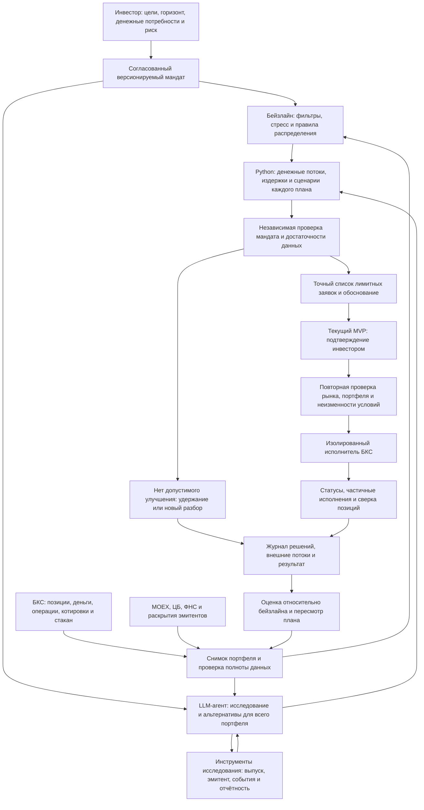

# ML System Design Doc — Invest Agent

Автор: Андрей Яковлев. Дата: 29.10.2026.
Стадия: развитие существующего MVP; HW1 — сетап и проектирование системы.
Структура основана на [шаблоне Reliable ML](https://github.com/IrinaGoloshchapova/ml_system_design_doc_ru/blob/main/ML_System_Design_Doc_Template.md).

## 1. Цели и предпосылки

### 1.1. Зачем идём в разработку продукта

Invest Agent — агент управления инвестиционным портфелем частного инвестора.
Инвестор передаёт ему портфель, задаёт цели и согласует инвестиционный мандат.
Агент анализирует весь переданный портфель, исследует инструменты, выбирает
между удержанием, покупкой и продажей, исполняет разрешённые операции и
отслеживает результат. Какую часть своего капитала передать в управление,
инвестор решает самостоятельно.

Цель продукта — повысить качество соотношения риска и доходности портфеля и
снизить трудозатраты инвестора на исследование и управление. Агент должен
помогать достигать разных целей: накопления капитала, регулярного денежного
потока, сохранения средств к сроку. Достижимость целей зависит от капитала,
горизонта и принятого риска; система должна выявлять противоречия и предлагать
компромиссы, а не обещать одновременно максимальную доходность и сохранность.

Целевое состояние — автономное управление: покупки и продажи внутри
согласованного мандата без подтверждения каждой операции. В текущем MVP
человек подтверждает конкретные сделки. Изменение мандата требует решения
инвестора и в целевой системе.

Сегодня уже существует облигационная версия с источниками данных, расчётами,
рекомендациями и исполнителем. Следующий продуктовый инкремент — связать эти
части в проверяемый цикл управления: профиль инвестора, план портфеля,
решение, исполнение, оценка результата и пересмотр плана.

LLM используется для понимания целей, планирования исследования, сопоставления
разнородных свидетельств и подготовки обоснованного инвестиционного решения.
Польза такого подхода проверяется относительно текущих правил и простых
стратегий. Денежные расчёты и проверка ограничений выполняются программно.
Обучение собственной модели не является обязательным условием проекта.

Успех — решения соответствуют мандату, финансовый результат измеряется
корректно, а инвестор тратит меньше времени на полный цикл управления.
Улучшение доходности при сопоставимом риске — проверяемая гипотеза продукта;
короткая серия удачных сделок сама по себе её не подтверждает.

### 1.2. Бизнес-требования и ограничения

#### Инвестиционный профиль и мандат

Агент выясняет цели, горизонт, потребность в выплатах, планируемые пополнения
и изъятия, ограничения и отношение к потерям. Он различает готовность
инвестора рисковать и его способность понести потери. Затем показывает
достижимые варианты риска и доходности и фиксирует выбранный мандат.
Такой подход соответствует практике индивидуального управления: профиль
содержит ожидаемую доходность, допустимый риск и инвестиционный горизонт
([Банк России](https://cbr.ru/Queries/XsltBlock/File/62016/65),
[CFA Institute](https://www.cfainstitute.org/insights/professional-learning/refresher-readings/2026/basics-of-portfolio-planning-and-construction)).

Мандат включает цели и их приоритеты, валюту, горизонт, ограничения по риску,
ликвидности и концентрации, допустимые инструменты, план денежных потоков,
порядок пересмотра и полномочия агента. Если для оценки способности нести
потери нужны сведения вне переданного портфеля, агент запрашивает их и
фиксирует границы доступной информации.

| Бизнес-требование | Ожидаемое поведение и проверка |
| --- | --- |
| Управлять всем переданным портфелем | Покупки и продажи оцениваются по влиянию на портфель целиком; существующие позиции входят в анализ |
| Поддерживать разные цели инвесторов | Цели и ограничения хранятся в версионируемом мандате; персональные настройки не становятся общими константами |
| Выбирать компромисс риска и доходности | Сравниваются альтернативы и сценарии; недостижимая цель явно обсуждается с инвестором |
| Исследовать рынок и эмитентов | Для существенных фактов сохраняются источник, время и привязка к выпуску/эмитенту |
| Формировать исполнимый план | Действия содержат инструмент, сторону, количество, лимитную цену, издержки и влияние на ограничения |
| Объяснять решение | Показаны основания, альтернативы, риски, неопределённость и условия пересмотра |
| Учитывать выбор человека | Отклонённая рекомендация и фактически выбранная сделка различаются в журнале |
| Контролировать исполнение | Подтверждены состояние заявки, частичные исполнения и итоговые позиции; повторный запуск не дублирует заявку |
| Реагировать на изменения | Устаревшее предложение блокируется; новые условия требуют нового плана и подтверждения в текущем режиме |
| Уметь бездействовать | Отсутствие подходящей возможности допускает сохранение денег или защитное размещение; падение цены само по себе не означает продажу |
| Оценивать результат | Учитываются сделки, купоны, погашения, комиссии, налоги при наличии данных и внешние денежные потоки |

#### Ограничения

Текущая предметная область — российский облигационный портфель. Имеющиеся
акции учитываются в общей структуре и риске; качество самостоятельной стратегии
акций в этой итерации не заявляется. Основной брокер MVP — БКС, интерфейс —
диалог с Codex. Мультиброкерность и массовый клиентский сервис отложены.

Мандат существующего пилота описан в [INVESTMENT_MANDATE.md](INVESTMENT_MANDATE.md)
и `config/investment_policy.toml`: ориентир 20% годовых, горизонт 5–10 лет,
риск-бюджет просадки 10–15%. Это настройки одного инвестора, а не требования
ко всем пользователям. Ожидаемая доходность не гарантируется; сценарный стресс
не равен фактической максимальной просадке и не гарантирует её ограничения.

Текущий режим сохраняет отдельное подтверждение конкретных сделок и
изолированный исполнитель. Аналитика не получает торговый токен. Запрещены
плечо, деривативы, выводы и переводы; заблокированные иностранные активы —
только удержание. При изменении инструмента, стороны, объёма или лимитной цены
нужно новое подтверждение. Нельзя повышать риск ради достижения цели доходности.

При недоступных или противоречивых данных агент обозначает пробел и блокирует
решения, для которых эти данные критичны. Внешние документы — источник фактов,
их инструкции не исполняются. Секреты и персональная история брокерского счёта
не публикуются в учебном репозитории.

### 1.3. Скоуп проекта и итерации

| Область | Состояние и границы |
| --- | --- |
| Существующий фундамент | Чтение БКС, MOEX, рейтинги ЦБ, РСБУ ФНС, индекс раскрытий, сценарии ставок, правила рекомендаций, policy engine, подтверждение и исполнитель |
| HW1 | Ruff, форматирование, pre-commit, CI, README и дизайн всей системы |
| Следующий проверяемый инкремент | Профиль и версия мандата, журнал полного цикла решения, учёт денежных потоков и результата, оценка на реальном портфеле |
| Развитие агентного анализа | Планирование исследования, сравнение действий по всему портфелю, проверка достаточности доказательств, пересмотр позиции |
| Целевая автономность | Самостоятельные покупки и продажи в рамках согласованного мандата после отдельной проверки готовности; текущие разрешения на торговлю не расширяются |
| Вне текущей итерации | Своя обученная LLM, высокочастотная торговля, деривативы, мультиброкерность, промышленный сервис для множества клиентов |

Извлечение отчётности с цитатами — возможный инструмент исследования эмитента,
а не отдельная цель продукта. Его приоритет определяется тем, какие данные
необходимы для конкретного инвестиционного решения.

Код воспроизводится из lock-файла; тесты работают на fixtures без боевых токенов.
Эксперимент фиксирует снимок данных, версию кода, мандата, модели и промпта.
Планируемый технический долг: ручная сверка части брокерской истории,
ограниченная полнота исторических источников, локальное хранение, отсутствие
постоянного фонового контроля. Эти ограничения учитываются при оценке пилота.

### 1.4. Предпосылки решения

- Агент управляет только явно переданным портфелем и в пределах согласованных
  полномочий. Мандат пересматривается при изменении целей или обстоятельств.
- Для решений нужны позиции и доступные деньги, котировки и ликвидность,
  денежные потоки выпусков, кредитные сведения и сведения о существенных событиях.
- Единицы анализа: портфель, эмитент по ИНН, выпуск по ISIN и регистрационному
  номеру. Риск концентрации агрегируется по эмитенту; связь с группой требует
  отдельного подтверждения.
- Горизонт цели клиента отличается от горизонта модели. Текущие сценарии ставок
  рассматривают 12 месяцев; денежные потоки облигации — до погашения/оферты.
- Рейтинг — свидетельство кредитного качества; используемый сценарный haircut
  не является вероятностью дефолта. РСБУ юрлица не заменяет МСФО группы.
- Пересмотр вызывается пополнением, существенным событием, изменением мандата
  или плановым обзором. Частота торговли определяется полезностью изменения
  после издержек; ежедневное наблюдение не требует ежедневных сделок.
- Доходность к погашению отдельной бумаги не равна реализованной доходности
  портфеля. Без полной истории внешних потоков доходность не рассчитывается.

## 2. Методология

### 2.1. Постановка задачи

Задача — последовательное принятие решений по управлению портфелем при
ограничениях и неопределённости. Состояние включает позиции, деньги, рыночные
и кредитные сведения, историю операций и мандат. Действия — удержание,
покупка, продажа, изменение распределения и запрос недостающих сведений.

Для множества допустимых планов A(s, m), определяемого состоянием s и мандатом m,
выбирается план с наибольшей ожидаемой полезностью для целей инвестора после
издержек. Полезность учитывает доходность, риск и сроки денежных потребностей.
Единую функцию полезности для всех клиентов заранее не задаём: параметры
определяются профилем, а альтернативы показываются через сценарии.

**Бейзлайн:** текущий детерминированный механизм рекомендаций: фильтры выпусков,
рейтинговые стресс-сценарии, лимиты концентрации и сравнение удержания,
вложения кэша и ребалансировки. Его версию и настройки фиксируем до оценки.

**Развиваемое решение:** агент на готовой LLM выбирает необходимые исследования,
собирает свидетельства, формирует несколько структурированных планов и
обосновывает выбор. Python-инструменты рассчитывают каждый план; независимый
policy engine проверяет ограничения. Агент не может отменить запрет текстом.
Противоречия запускают уточнение/пересчёт, а не обход проверки.

Обучение своей модели и reinforcement learning на реальном счёте не требуются.
Качество оценивается на уровне всего цикла: обоснование, соответствие мандату,
исполнение и последующий финансовый результат.

### 2.2. Блок-схема решения

Бейзлайн и развиваемый агент используют одинаковые снимки данных и проверки.

Целевая автономная версия заменяет подтверждение каждой сделки проверкой заранее
выданных полномочий в мандате. Это отдельный этап внедрения; HW1 не включает
изменение действующего торгового режима.

### 2.3. Данные и этапы решения

| Данные | Источник и доступность | Необходимая проверка |
| --- | --- | --- |
| Позиции, деньги, заявки | Интеграция БКС существует | Время, режим расчётов, заблокированные активы, соответствие исполнению |
| Сделки и внешние потоки | Локальные журналы есть; полнота брокерской истории требует проверки | Пополнения/выводы отдельно от купонов, погашений и сделок; комиссии и налоги |
| Выпуски, котировки, выплаты | Клиент MOEX и брокерские данные существуют | ISIN, торговый режим, НКД, амортизация, оферта, задержка котировки |
| Кредитные сведения | Рейтинги ЦБ, РСБУ ФНС, индекс раскрытий существуют | Сущность, дата публикации, полнота; содержание документов разбирается отдельно |
| Мандат | TOML текущего пилота существует | Отделить настройки клиента от общих правил, версионировать изменения |
| Решения и вмешательства человека | Часть истории есть в обсуждениях и локальных артефактах | Разделить предложение агента, выбор человека, отправку и исполнение |
| Эталонные сценарии | Предстоит собрать из обезличенной истории и fixtures | Нормальный рынок, отсутствие данных, ухудшение кредита, частичное исполнение |

1. **Аудит данных и EDA.** Проверить покрытие истории сделок и потоков,
   сверить позиции и остатки. Выделить доступный период корректного расчёта
   результата и пробелы. Выход — реестр источников и воспроизводимая сверка.
2. **Фиксация бейзлайна.** Сохранить версию текущего алгоритма и мандата.
   Записывать его решения на тех же снимках, что получает развиваемый агент.
   Для каждого решения фиксировать вариант без торговли.
3. **Цикл агентного управления.** Добавить структурированные вход/выход:
   состояние, версия мандата, основания, альтернативы, расчёт последствий,
   условия пересмотра и предполагаемые заявки. Протестировать исследования
   эмитента и отказ при недостаточной информации.
4. **Журнал и учёт результата.** Связать решение, подтверждение, исполнение,
   позиции и денежные потоки. Не приписывать агенту сделку, выбранную человеком
   вопреки исходной рекомендации. Данные реального счёта остаются приватными.
5. **Оценка и пилот.** Проверить сценарии на истории без доступа к будущим
   сведениям, затем наблюдать реальные решения и сделки. Улучшение промптов и
   правил выполнять на development-периоде; последующий период держать
   отложенным. Границу фиксировать до оценки после проверки покрытия данных.

Для финансовой оценки разбиение хронологическое. Используем дату публикации,
а не отчётный период документа; исключаем будущие рейтинги и известные позже
дефолты. При отсутствии исторического снимка пример подходит для проверки
процесса, но не для достоверного backtest. Тестовые сценарии охватывают также
эмитентов вне использованных при настройке примеров.

## 3. Подготовка пилота

### 3.1. Способ оценки

Первый пилот — существующий реальный портфель автора и его реальные сделки.
Новые операции выполняются только по отдельному разрешению владельца в текущем
режиме. Пилот не требует торговать ради количества наблюдений: решение
«ничего не менять» также сохраняется и оценивается.

Для каждого эпизода сохраняются доступные на тот момент данные, план агента,
план бейзлайна, выбор владельца, исполнение и последующие выплаты/стоимость.
Сравнение с бейзлайном ведётся на виртуальном портфеле с одинаковыми стартовыми
позициями и внешними потоками. Для виртуальных сделок учитываются доступная
ликвидность, спред и издержки; исполнение по недоступной цене не предполагается.
Если необходимых данных нет, сравнение помечается ограниченным.

Простая рыночная альтернатива — облигационный total-return индекс,
соответствующий валюте и дюрации пилота, либо доступная защитная стратегия.
Точный ряд и правила сравнения фиксируются после EDA до оценки. Сравнение
риска обязательно: более высокая доходность за счёт большего кредитного риска
не считается автоматическим улучшением.

| Измерение | Метод |
| --- | --- |
| Результат портфеля | TWR при достаточной оценке на границах внешних потоков; XIRR для опыта инвестора при полной истории датированных потоков |
| Риск | Фактическая просадка, концентрация, ликвидность, сценарный стресс и кредитные события; показатели не подменяют друг друга |
| Издержки | Комиссии, спред, оборот, налоги при наличии подтверждённых данных; неизвестные статьи отмечаются |
| Качество решения | Соблюдение мандата, корректность расчётов, доказательность существенных утверждений, наличие альтернатив и условий пересмотра |
| Исполнение | Отклонения от подтверждённых условий, дубли, отказы, частичные исполнения и сверка с брокером |
| Трудозатраты | Время владельца на эпизод и число содержательных исправлений; задержка и стоимость работы агента |

Сделка с прибылью может быть плохим решением, а обоснованная сделка — дать
убыток. Поэтому процесс и результат оцениваются отдельно. Один инвестор и
короткий период ограничивают переносимость выводов; показываются длительность,
число решений и рыночные условия, а не заявление о доказанной альфе.

### 3.2. Что считаем успешным пилотом

Обязательные условия приёмки:

- Каждое действие связано с действующей версией мандата и проходит независимые
  проверки. В текущем режиме ни одна сделка не отправлена без подтверждения;
  нет дублей и расхождений с разрешёнными параметрами.
- Для каждого исполненного действия есть проверяемый итог: статус, количество,
  цена при наличии брокерских данных, издержки и сверка позиций. Частичное
  исполнение не представляется полным.
- Существенные факты имеют источники и время; критический пробел данных
  блокирует зависимое решение. Модельные оценки обозначены как оценки.
- Результат считается только за период с достаточной историей потоков;
  прирост стоимости из-за пополнений не называется доходностью.
- Работает полный цикл от мандата до пересмотра результата, включая удержание,
  продажу и сценарии ошибок, а не только успешную покупку.

Гипотезы продуктовой ценности: доходность после издержек при сопоставимом риске
выше бейзлайна, риск лучше соответствует мандату, время владельца сокращается.
Для каждой показывается измеренный результат; числовые пороги превосходства
и минимальную длительность финансовой оценки определяем после EDA с учётом
доступного периода и частоты решений. В HW1 не заявляем выдуманные результаты
или произвольную гарантию доходности. Прохождение технической приёмки не
равнозначно доказанному финансовому превосходству и не разрешает автономную торговлю.

### 3.3. Подготовка и ресурсы

Текущая инфраструктура — локальный Python-проект, готовая LLM в Codex,
API источников, приватные снимки и журналы. GPU и обучение собственной модели
на этом этапе не нужны. Стоимость и длительность одного цикла измеряются
отдельно для планового обзора и углублённого исследования эмитента.

Для ограничения затрат используются кеширование с датой актуальности,
повторное использование снимка в одном эпизоде, лимит шагов исследования и
таймаут. По исчерпании бюджета агент возвращает неполный результат и
необходимые сведения, а не выдумывает вывод. Численные лимиты устанавливаются
по измерениям первых прогонов.

После проверки пилота отдельным решением определяется готовность к автономному
режиму: полномочия, лимиты операций, остановка при нарушениях, фоновый контроль
и восстановление после сбоя. Для вывода продукта на других инвесторов также
потребуются отдельная проработка правовой модели, доступа и изоляции данных.
