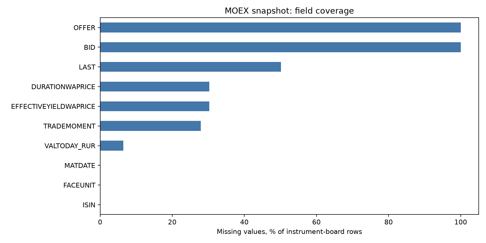
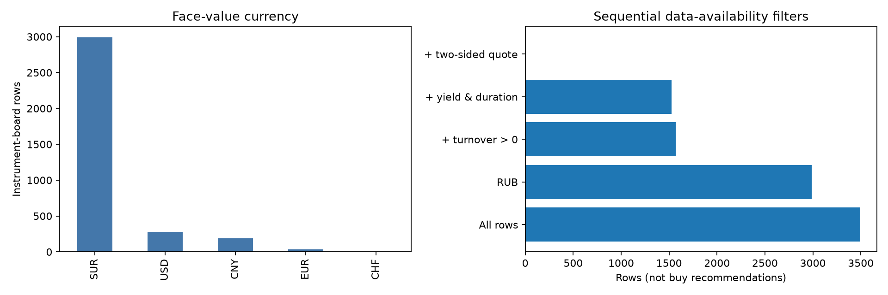
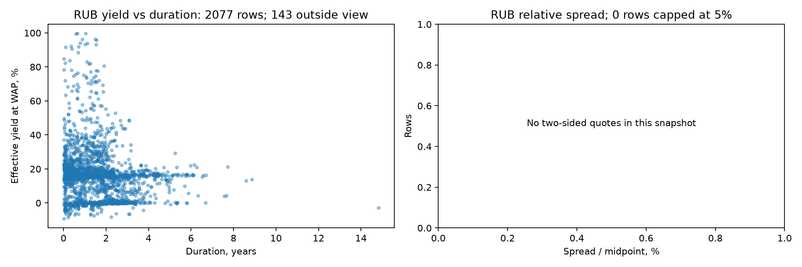

# EDA данных Invest Agent — HW2

Исследование выполнено 15.11.2026 на публичном снимке MOEX ISS. Цель — проверить,
достаточно ли доступных рыночных данных для отбора облигаций и оценки решений
агента. Личный портфель, токены и торговые операции не использовались.

## Данные и воспроизведение

[Исходный запрос](https://iss.moex.com/iss/engines/stock/markets/bonds/securities.json?iss.meta=off&iss.only=securities,marketdata,marketdata_yields)
сохранён без изменений в `datasets/raw/moex_bonds.json`. Контрольная сумма и все
числа — в [eda_summary.json](eda_summary.json). Нормализованный результат —
[bond_snapshot.csv](bond_snapshot.csv). Это один поперечный снимок, а не история.
Источник содержит доступные строки рынка bonds; полнота относительно всех
существующих выпусков и других рынков не заявляется.

Запуск из корня репозитория:

```bash
uv run --with pandas==3.1.1 --with matplotlib==3.11.2 python scripts/eda.py
```

Скрипт читает сохранённый JSON без сети, проверяет уникальность составного ключа
и соответствие marketdata справочнику, соединяет таблицы с validate=one_to_one,
создаёт CSV, сводный JSON и три графика. Python 3.14 использован при проверке;
для EDA окружение отделено от runtime приложения. Версии зависимостей фиксированы
в `requirements-eda.txt`.

## Состав и единица наблюдения

| Таблица | Строк | Назначение |
| --- | ---: | --- |
| securities | 3 493 | Паспорт, номинал, валюта, даты и купон |
| marketdata | 3 493 | Последние цены, оборот и время |
| marketdata_yields | 2 519 | Эффективная доходность, дюрация и дата сделки |

Уникальных SECID и ISIN — 3 179. Есть 314 повторных SECID по разным торговым
режимам; дублей `(SECID, BOARDID)` нет. Сливать по одному ISIN нельзя:
получатся размноженные строки и неверные веса. Представлены 2 989 строк SUR,
277 USD, 191 CNY, 32 EUR и 4 CHF; это валюта номинала, а не гарантия валюты
расчётов. Доходности разных валют нельзя ранжировать как однородную величину.

## Полнота и время



ISIN, валюта и дата погашения заполнены во всех строках; это не доказывает их
семантическую корректность. Нет LAST у 50,1%, эффективной доходности и дюрации
по WAP у 30,3%, времени сделки у 27,9%, рублёвого оборота у 6,5% строк.
BID/OFFER отсутствуют у 100%. Пропуск не заменяем нулём: отсутствие котировки
отличается от нулевого оборота. Невозможно оценить распределение спредов —
пустая панель на графике показывает отсутствие данных.

Время SYSTIME: 15.11.2026 06:42:52–19:15:18; TRADEMOMENT:
15.10.2026 23:59:59–15.11.2026 18:59:57 (время как возвращено ISS).
Свежая загрузка не означает свежую сделку. Для решения нужны отдельные времена
получения, наблюдения и публикации. Историческую полноту одним снимком не проверить.

## Пригодность для отбора



Последовательная воронка: 3 493 строки → 2 989 рублёвых → 1 571 с положительным
оборотом → 1 524 с доходностью и положительной дюрацией → **0** с корректной
двусторонней котировкой. Это фильтры наличия данных, не инвестиционный мандат
и не список покупок. Нельзя оценить ликвидность только по факту дневного оборота.
Полный отбор требует кредитного покрытия, оферты, амортизации и свежего стакана.



В рублёвых строках с доходностью и положительной дюрацией медиана эффективной
доходности 16,00%, 95-й перцентиль 93,92%; минимум −226,88%, максимум
5 885 919,35%. Это наблюдения источника, а не прогноз достижимого результата.
Экстремумы требуют проверки даты, цены, близости выплаты и вида доходности;
автоматически считать их выгодными нельзя. На графике явно ограничена ось
доходности [-10; 100], число исключённых точек подписано; исходные значения
сохранены в CSV. Средняя доходность без такой проверки вводит в заблуждение.

## Остальные источники и разметка

В `tests/fixtures` есть контрактные примеры БКС, MOEX, рейтингов ЦБ, ФНС и
раскрытий. Они предназначены для тестов парсеров, не являются независимой
репрезентативной выборкой и не дополняют объём рынка в этом EDA. Один эмитент
не позволяет оценить кредитное покрытие. Публикации и отчётные периоды нельзя
использовать как взаимозаменяемые даты. Наличие ссылки на PDF не доказывает
содержание ковенанта. Покрытие рейтингов и документов всего рынка не измерено.

Нет размеченных эпизодов решений, временного ряда снимков, полной истории
внешних потоков и реализованных контрфактических доходностей. Поэтому обучение,
backtest и превосходство агента здесь не заявлены. Для следующего этапа нужен
журнал as-of снимков, независимая разметка фактов и допустимых действий; план
сбора и объём описаны в разделе 2.3 дизайн-документа.

## Решения по результатам EDA

1. Хранить составной ключ и справочник соответствия выпуск–эмитент; концентрацию
   считать по эмитенту, а не числу строк рынка.
2. Отделить фильтр наличия данных от проверки мандата и исполнимости; отсутствие
   критичных сведений означает отказ от действия, а не заполнение LLM.
3. Разделять валюты и типы доходности; экстремумы отправлять на проверку источника.
4. Собирать историю публикаций и котировок до финансового сравнения; сегодняшним
   снимком нельзя восстановить доступное прошлому агенту знание.
5. Публиковать только публичный снимок и обезличенные тестовые сценарии;
   брокерскую историю и мандат конкретного клиента хранить приватно.
